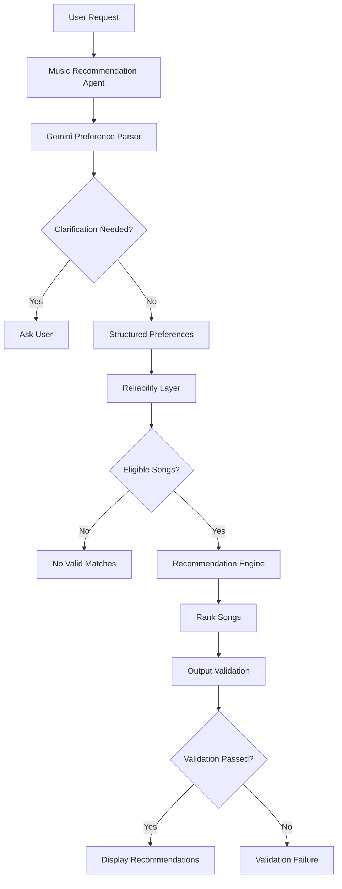

# 🎧 VibeFinder 2.0 — AI-Powered Music Discovery Assistant

**An Applied AI System combining natural-language understanding, deterministic music recommendations, and reliability validation.**

VibeFinder 2.0 transforms the original content-based VibeFinder music recommender into an AI-powered music discovery assistant. Instead of manually entering preferences, users can describe the music they want in everyday language.

For example:

> "I want calm instrumental music for studying, nothing too energetic."

The application uses Google's Gemini API to interpret the request, converts it into structured preferences, and passes those preferences to an existing Python recommendation engine. A separate reliability layer filters songs against supported explicit constraints and validates the final recommendations.

## 1. Project Overview

### The Problem

Traditional recommendation simulations often require users to provide structured preferences such as genre, mood, energy, and tempo.

Real users are more likely to describe what they want conversationally:

- "Give me something relaxing for studying."
- "I want energetic rock for my workout."
- "Recommend instrumental music without too much energy."
- "I need something calm for a late-night coding session."

VibeFinder 2.0 bridges the gap between natural-language requests and structured recommendation systems.

### The Solution

The application combines three main capabilities:

1. **Natural-language understanding:** Gemini extracts structured musical preferences from a user's request.
2. **Deterministic recommendation:** The existing Python recommendation engine calculates scores and ranks songs.
3. **Reliability validation:** Explicit supported constraints are applied before ranking, and recommendation outputs are checked before being returned.

The language model interprets the request; Python remains responsible for recommendation scoring and ranking.

## 2. Key Features

- Natural-language music requests.
- Gemini-powered structured preference extraction.
- Pydantic validation of extracted preferences.
- Clarification handling for ambiguous requests.
- Content-based music recommendation.
- Existing Strategy Pattern with four recommendation strategies.
- Explicit constraint filtering.
- Recommendation output validation.
- No-valid-matches handling.
- Command-line user interface.
- Automated tests using mocked components.

## 3. System Architecture

The system follows a modular architecture:



The editable Mermaid source is available at:

[`diagrams/architecture.mmd`](diagrams/architecture.mmd)

### Component Responsibilities

| Component | Responsibility |
|---|---|
| `llm_client.py` | Communicates with the Gemini API |
| `preference_parser.py` | Converts natural-language requests into structured preferences |
| `agent.py` | Coordinates the recommendation workflow |
| `recommender.py` | Scores and ranks songs deterministically |
| `reliability.py` | Filters candidates and validates recommendations |
| `ai_main.py` | Provides the command-line interface |

## 4. Technology Stack

- **Python:** Main application language.
- **Google Gemini API:** Natural-language preference extraction.
- **Google Gen AI SDK:** Gemini API integration.
- **Pydantic:** Structured output validation.
- **CSV:** Local music catalog.
- **pytest:** Automated testing.
- **python-dotenv:** Environment variable management.
- **Git and GitHub:** Version control and project collaboration.

## 5. Getting Started

### Prerequisites

- Python 3.10 or newer.
- Git.
- A Google Gemini API key.

### Step 1 — Clone the Repository

```bash
git clone https://github.com/nayem-xy/applied-ai-system-project.git

cd applied-ai-system-project
```

### Step 2 — Create a Virtual Environment

```bash
python3 -m venv .venv
```

Activate it:

**macOS / Linux**

```bash
source .venv/bin/activate
```

**Windows**

```bash
.venv\Scripts\activate
```

### Step 3 — Install Dependencies

```bash
pip install -r requirements.txt
```

### Step 4 — Configure the Gemini API Key

Create a local environment file from the provided template:

```bash
cp .env.example .env
```

Open `.env` and replace the placeholder with your own Gemini API key:

```env
GEMINI_API_KEY=your_actual_api_key_here
```

You can obtain an API key through [Google AI Studio](https://aistudio.google.com/app/apikey).

**Security:** Never commit your actual `.env` file or expose your API key. The repository's `.gitignore` excludes `.env` files while allowing `.env.example` to be committed.

### Step 5 — Run VibeFinder 2.0

From the project root:

```bash
python -m src.ai_main
```

The application will ask for a natural-language music request.

Type `exit` to close the application.

## 6. Example Requests and Expected Behavior

The following scenarios demonstrate the intended application behavior.

### Example 1 — Instrumental Study Music

**Input**

```text
I want calm instrumental music for studying,
nothing too energetic.
```

**Expected workflow**

1. Gemini extracts the user's music preferences.
2. The parser creates structured preferences.
3. The reliability layer applies supported instrumental and low-energy constraints.
4. The recommendation engine ranks eligible songs.
5. The validation layer checks the recommendations.
6. The application displays the results if validation succeeds.

### Example 2 — Release Decade Restriction

**Input**

```text
I only want music from the 1990s.
```

**Expected workflow**

The system identifies the requested release decade and applies the decade constraint. If no catalog songs satisfy the restriction, it returns a no-valid-matches response rather than recommending songs outside the requested decade.

### Example 3 — Ambiguous Request

**Input**

```text
Play something.
```

**Expected workflow**

The parser identifies insufficient information or low confidence and asks the user for clarification instead of immediately generating recommendations.

**Note:** These are representative workflow scenarios. They are not claims that all three requests have been successfully completed through a live Gemini API session.

## 7. Reliability and Guardrails

VibeFinder 2.0 includes a dedicated reliability component.

### Explicit Constraint Filtering

The current implementation supports these constraint checks:

| Constraint | Enforcement |
|---|---|
| Instrumental only | Instrumentalness must be at least 0.80 |
| Nothing too energetic | Energy must be no greater than 0.50 |
| Specific release decade | Candidate must match the requested decade when identified as an explicit decade constraint |

These thresholds are engineering choices for this educational prototype, not scientifically established definitions.

The implementation supports a limited set of natural-language phrases. It does not guarantee enforcement of every possible user restriction.

### Output Validation

Before returning recommendations, the application checks:

- Whether each recommended song belongs to the eligible catalog.
- Whether each recommendation has a numeric score.
- Whether each recommendation has a valid explanation string.

### Failure Handling

The application handles several possible outcomes:

- `success`: Recommendations passed validation.
- `needs_clarification`: The user needs to provide more information.
- `no_valid_matches`: No catalog songs satisfy the supported constraints.
- `validation_failed`: Recommendation output did not pass validation.

The CLI also catches request-processing errors and allows the user to try again.

## 8. Testing and Evaluation

The project includes automated tests for the original recommender, reliability component, and AI agent workflow.

Run the test suite:

```bash
python -m pytest -v
```

Current test result:

```text
12 passed
```

### Test Coverage

The tests cover:

- Existing recommendation functionality.
- Instrumental-only filtering.
- Low-energy filtering.
- Release-decade filtering.
- No-valid-matches behavior.
- Recommendation validation.
- Successful agent execution with mocked components.
- Clarification handling.
- Invalid or empty recommendation scenarios.

The agent tests use mocked components so that core application behavior can be tested without requiring a live Gemini API call.

### External API Availability

The application was launched and a live request was submitted to Gemini. The API returned a `503 UNAVAILABLE` response because the selected model was experiencing high demand.

This is an external service-availability limitation, not evidence of a successful live recommendation. The automated tests are independent of Gemini availability.

## 9. Original Project: VibeFinder 1.0

VibeFinder 2.0 builds on the original VibeFinder content-based recommendation system.

The original project:

- Loaded songs from a CSV catalog.
- Compared song attributes with structured user preferences.
- Calculated weighted recommendation scores.
- Ranked the highest-scoring songs.
- Generated explanations for recommendations.

The original project also introduced the Strategy design pattern with:

- `BalancedStrategy`
- `GenreFirstStrategy`
- `MoodFirstStrategy`
- `EnergyFirstStrategy`

The original command-line simulation can still be explored through:

```bash
python -m src.main
```

The original recommendation engine remains an important part of VibeFinder 2.0.

## 10. Dataset

The local catalog contains 18 songs.

Each song includes:

- Genre and mood.
- Energy, tempo, valence, danceability, and acousticness.
- Popularity.
- Release decade.
- Mood tags.
- Language.
- Instrumentalness.

Some additional metadata is illustrative and simulated.

The dataset is intentionally small for classroom experimentation. It is not a commercial music catalog and does not provide the diversity of a real streaming platform.

## 11. Limitations and Future Improvements

### Current Limitations

- Only 18 songs are available.
- Some metadata is illustrative.
- Explicit constraint recognition supports limited phrase patterns.
- Reliability thresholds are manually selected.
- Gemini API availability and response latency can affect the live application.
- No listening history or collaborative filtering is implemented.
- No large-scale recommendation-quality evaluation has been performed.
- Retrieval-augmented generation and model fine-tuning are not implemented.

### Future Improvements

- Expand the song catalog.
- Improve natural-language constraint recognition.
- Introduce more robust handling of conflicting preferences.
- Add recommendation diversity.
- Incorporate user feedback.
- Explore retrieval-augmented generation for larger music catalogs.
- Develop a larger automated evaluation dataset.
- Compare preference-extraction performance across different language models.

## 12. Project Structure

```text
applied-ai-system-project/
│
├── data/
│   └── songs.csv
│
├── diagrams/
│   └── architecture.mmd
│
├── logs/
│   └── agent_traces.md
│
├── src/
│   ├── agent.py
│   ├── ai_main.py
│   ├── llm_client.py
│   ├── preference_parser.py
│   ├── reliability.py
│   ├── recommender.py
│   ├── song.py
│   └── ...
│
├── tests/
│   ├── test_agent.py
│   ├── test_reliability.py
│   └── test_recommender.py
│
├── .env.example
├── .gitignore
├── ai_interactions.md
├── model_card.md
├── README.md
└── requirements.txt
```

## 13. AI Collaboration and Development

AI tools were used throughout development to support:

- Architecture planning.
- Structured preference extraction.
- Python implementation and debugging.
- Reliability and validation design.
- Test-case development.
- Documentation and reflection.

An important design decision was to keep recommendation ranking deterministic rather than allowing the language model to invent or directly rank songs.

The development process also involved checking AI-generated suggestions against the actual code and dataset, revising test expectations, and documenting limitations.

More details are available in:

- [`ai_interactions.md`](ai_interactions.md)
- [`model_card.md`](model_card.md)
- [`logs/agent_traces.md`](logs/agent_traces.md)

## 14. Project Information

**Project:** VibeFinder 2.0 — AI-Powered Music Discovery Assistant

**Project Type:** Applied AI System

**Core Approach:** Natural-language understanding + deterministic content-based recommendation + reliability validation.

**Repository:** [GitHub — applied-ai-system-project](https://github.com/nayem-xy/applied-ai-system-project)

---

*Built as an educational project exploring how generative AI can be integrated with traditional software systems to create a useful, testable, and more reliable application.*


## Evaluation Harness

VibeFinder includes a reproducible evaluation harness that tests
five predefined end-to-end agent scenarios without requiring live
Gemini API calls.

Run it with:

```bash
python -m src.evaluate